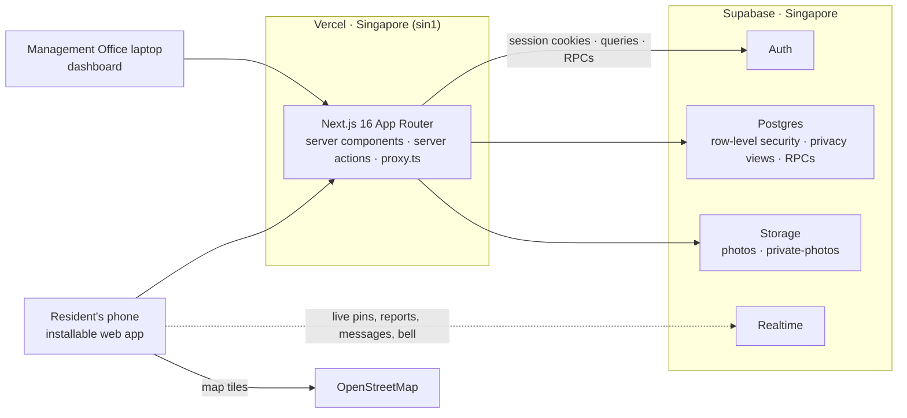

# Serumpun — how the system works

Serumpun ("of the same root") is a phone-first web app for the residents of a Sime Darby Property township, starting
with **City of Elmina**, and a laptop dashboard for its **Management Office**. Live at
**https://serumpun-six.vercel.app**.

Contents: [The problem](#1-the-problem) · [Feature tour](#2-feature-tour) · [Roles](#3-roles-and-verification) ·
[Architecture](#4-architecture) · [Data model](#5-data-model) · [Security](#6-security-model) ·
[Points](#7-points) · [Languages and themes](#8-languages-and-themes) · [Every township](#9-built-for-every-sdp-township) ·
[Demo accounts](#10-demo-accounts-and-reset) · [Run locally](#11-run-it-locally) · [Deploy](#12-deploy) ·
[Limits](#13-known-limits-and-later) · [Credits](#14-credits) · [Links](#15-links)

## 1. The problem

Today a township's life runs through a Facebook group. Reports to the Management Office get lost in the feed and
nobody knows whether anyone saw them. Warnings (stray dogs, a flood, a fallen tree) scroll away and go stale. Help,
events and things to lend are mixed with everything else, and residents' details are on show.

Serumpun puts it in one place, built around an **official reporting channel to the Management Office with public status
tracking**: every report has a reference number, a public timeline and a Me too count, and the office answers from its
dashboard. Around it: a live map of short-lived neighbourhood alerts, groups, events with points, services, share and
lend, messages, court booking and vouchers. Homes stay private: residents see names and neighbourhoods, never a unit
number.

## 2. Feature tour

| Screen | Where | What it does |
|---|---|---|
| Home | `/home` | Greeting, township and points; "Report an issue" (straight to the office); 8 tiles; **Happening now**: the nearest neighbour alert, the office's latest announcement and your next event. |
| Live Map | `/map` | Alerts as pins (accident, snake, suspicious person, stray dogs, flood, fallen tree, walkway blocked, streetlight, police, and the office's road works and water cuts). Neighbours vote **Still there** or **Gone**; an alert fades 2 hours after its last confirmation. Search, filters, drop an alert, and "Send to Management Office" for lasting problems. |
| Report an issue · Issue Board | `/reports/new` · `/reports` | Category, photo and place; "Already reported nearby?" offers **Me too** instead of a duplicate. Timeline: submitted → acknowledged → in progress → resolved, then the reporter confirms the fix (or it reopens). Private reports (security) are seen only by the reporter and the office. |
| Management Office | `/dashboard` | Reports board with updates and after-photos, residents to approve, official map pins, events to approve (points), announcements, rewards and vouchers, and Reset demo data. |
| Community | `/community` | **Groups** (posts, questions with a top answer, Helpful), **Events** (Going, QR check-in, points), **Services** (offers and requests in Tutoring, Repairs, Cleaning, Food, Childcare, Eldercare, Pets, Others), **Share & Lend** (lend, give away or swap; borrowing in 4 steps). |
| Messages | `/messages` | One-to-one chats about a post, a service or a listing; live, with unread badges. |
| Book a Court | `/book` | Badminton (2 courts), futsal, tennis and the hall. Free 1-hour slots from 7 am to 11 pm, up to 7 days ahead, 2 hours a day per household; a booking pass with QR and a calendar file; cancel up to 2 hours before. |
| Rewards | `/rewards` | Vouchers for points at Elmina Lakeside Mall; "Slide to use" at the counter. |
| Me | `/me` | Points and the next reward; my vouchers, reports, bookings and listings; points history; dark mode; language; township; sign out. |
| Notifications | `/notifications` | Report updates, borrow steps, comments, announcements and account news, with a live bell. |

**The 5-minute demo story**

1. Landing → **Try as Aisyah** → switch to Bahasa Malaysia (Me › Language).
2. Home › Happening now → the nearest alert opens the **Live Map** on it → vote Still there.
3. **Report** a broken streetlight → "Already reported nearby?" → **Me too** → open the report's timeline.
4. On a laptop: **Try as Management Office** → move a report to *In progress* with an update → Aisyah's phone updates
   **live** → the Issue Board.
5. **Events**: check in with the event's QR → points → **Rewards** → redeem Free kopi → slide to use.
6. **Community**: the Mommies group's top answer · message a tutor · borrow a ladder · **Book a Court**.
7. **Me**: dark mode. Close on "built for every SDP township".

## 3. Roles and verification

| Who | Can |
|---|---|
| Visitor | See the landing page, sign up, or try a demo account. |
| Pending resident | Browse everything. Posting, voting, booking, borrowing and messaging wait for approval (a banner says so). |
| Verified resident | Everything residents do. |
| Rejected | Sees why, and nothing else. |
| Management Office | Its township's dashboard. |

Sign-up asks for a name, email, password, township, neighbourhood and **unit number**. Only the Management Office ever
sees the unit. The office approves or rejects new residents in Dashboard › Residents, and the resident is notified.

## 4. Architecture



- **Reads**: server components query Supabase as the signed-in user, so row-level security always applies.
- **Writes**: server actions call database functions (RPCs) that check the caller and the rules again; the page is never
  trusted. The service-role key is used only by trusted server code (sending notifications, the seed, the smoke test).
- **Live updates**: alerts and reports broadcast an id-only "something changed" on the township's channel and pages
  fetch again through the privacy views; messages and notifications arrive as row changes under row-level security.
- **Time**: every "today", slot and window is worked out in Malaysia time (Asia/Kuala_Lumpur); servers run in UTC.
- **Maps** use Leaflet with OpenStreetMap tiles (no paid keys). QR codes are made in the app.

| Folder | What is in it |
|---|---|
| `app/(auth)` | Landing, sign-up, the rejected screen |
| `app/(app)` | Every resident screen |
| `app/dashboard` | The Management Office |
| `components/<feature>` | Screens' parts, by feature |
| `lib/domain` | The rules as plain, tested functions (time, points, booking, reports, alerts…) |
| `lib/supabase` | Clients, the session and role checks, realtime hooks |
| `lib/i18n` | English and Bahasa Malaysia (`en.ts`, `ms.ts`) |
| `lib/seed` | The demo township |
| `supabase/migrations` | Schema, row-level security and RPCs, applied in order |
| `scripts` | `migrate.ts`, `seed.ts`, `smoke.ts` |
| `tests` | Vitest unit tests |

## 5. Data model

Every township-level table has `township_id`. Residents read through the views and functions in the last column.

| Area | Tables | Residents read through |
|---|---|---|
| People | `townships`, `profiles`, `profile_private` (unit, phone) | their own profile and unit |
| Office | `announcements`, `notifications` | their township's announcements, their own notifications |
| Live Map | `alerts`, `alert_votes` | `public_alerts` |
| Reports | `reports`, `report_metoo`, `report_updates`, `report_confirmations` | `public_reports`, `public_report_updates` |
| Events and points | `events`, `event_rsvps`, `points_ledger` | `public_events`, `my_points()` |
| Rewards | `rewards`, `redemptions` | the catalogue, their own vouchers |
| Groups | `groups`, `group_members`, `posts`, `comments`, `comment_helpful` | `public_groups`, `public_group_members`, `public_posts`, `public_comments` |
| Messages | `conversations`, `conversation_members`, `messages` | `my_conversations`, their own messages |
| Services | `services` | `public_services` |
| Share & Lend | `listings`, `borrow_requests` | `public_listings`, `my_borrows` |
| Book a Court | `facilities`, `bookings`, `booking_players` | the courts, their own bookings, `booked_slots()` |

## 6. Security model

- **Row-level security on every table.** Policies go through `my_township()`, `is_verified()` and `is_management()`,
  so a rejected account matches nothing and nobody sees another township.
- **Privacy views.** Residents read names and neighbourhoods only: never a unit number, a phone, or who posted an alert
  or a report. Tables that would leak (votes, Me toos, who wrote a step) give residents nothing at all.
- **Writes only through RPCs**: security-definer functions with an empty `search_path` and explicit grants. Each checks
  who is calling (verified, same township, owner) and the rule (dates, slots, steps, limits) again.
- **Photos** get random file names. A private report's photos sit in a private bucket, shown through short-lived signed
  links.
- **Only trusted code sends notifications**, so nobody can message a fake notice.
- **Double taps count once**: unique keys and locks make Me too, check-in, redeem (a request id per press), borrowing
  and booking (one per slot, 2 hours per household) safe to tap twice or at the same time.
- **Every page and action checks the session itself.** `proxy.ts` only sends signed-out visitors to the landing page.
- `npm run smoke` tries these rules against the live database as the demo accounts (15 checks).

## 7. Points

- **Earn** by checking in at an event with its QR, from an hour before it starts to three hours after: **150** points
  at the Management Office's events, **100** at a resident event once the office approves points for it. Once per
  person per event.
- **Spend** on vouchers at Elmina Lakeside Mall: Free kopi (250), RM10 off groceries (500), an hour at the kids'
  playland (600), RM15 off sportswear (1,500). A voucher lasts 30 days and is used by sliding it at the counter, beside a
  ticking clock so a screenshot cannot pass for it.
- The balance is the sum of the points ledger. Only check-in adds points and only redeeming spends them.

## 8. Languages and themes

Every screen is in **English** and **Bahasa Malaysia** (Me › Language; the choice is remembered). **Light**, **dark** or
the phone's setting (Me › Dark mode). Designed for phones 390 px wide, installable to the home screen; the dashboard is
for laptops.

## 9. Built for every SDP township

The `townships` table lists Sime Darby Property's townships: City of Elmina (live), Bandar Bukit Raja, Serenia City,
Ara Damansara, Bukit Jelutong, Nilai Impian, Bandar Ainsdale and Putra Heights. Sign-up asks for the township and says
"coming soon" for the others. Everything is scoped by township, so opening another one means switching it on, adding its
Management Office account, and its places, courts and rewards.

## 10. Demo accounts and reset

- The landing page has **Try as Aisyah** (verified resident, Elmina Valley 3), **Try as Nur** (waiting for approval)
  and **Try as Management Office**.
- **Daniel Tan** (`daniel.demo@example.com`, another household) is a second resident for two-phone demos. The demo
  password is not in this document: ask the team.
- **Dashboard › Reset demo data** (or `npm run db:seed`) wipes everything created since, deletes visitors' sign-ups,
  restores the demo accounts and seeds a lively Elmina dated around now. Seeded alerts fade after about two hours, so
  reset shortly before a demo.

## 11. Run it locally

You need Node 24, npm 11, and access to the Vercel project (or your own Supabase project with the same variables).

```bash
npm install
vercel env pull .env.local
npm run db:migrate
npm run db:seed
npm run dev
```

Variables (names only, never commit `.env*`): `NEXT_PUBLIC_SUPABASE_URL`, `NEXT_PUBLIC_SUPABASE_ANON_KEY` (or
`NEXT_PUBLIC_SUPABASE_PUBLISHABLE_KEY`), `SUPABASE_SERVICE_ROLE_KEY` (or `SUPABASE_SECRET_KEY`),
`POSTGRES_URL_NON_POOLING` (or `POSTGRES_URL`) for migrations, and `DEMO_PASSWORD`.

| Script | Does |
|---|---|
| `npm run dev` | Development server |
| `npm run build` · `npm run start` | Production build and server |
| `npm run lint` · `npm run typecheck` · `npm test` | ESLint, TypeScript, Vitest |
| `npm run db:migrate` | Applies new files in `supabase/migrations`, each in one transaction |
| `npm run db:seed` | Resets the demo data |
| `npm run smoke` | Privacy, pending-user, double-tap and limit checks on the live database, then a reset |

Two sessions on one computer (resident and office): `npm run build && npm run start -- -p 3001`, then use
`http://localhost:3001` and `http://127.0.0.1:3001` (the development server blocks 127.0.0.1).

## 12. Deploy

The Vercel project `serumpun` runs in Singapore (`vercel.ts`), with Supabase from the Vercel Marketplace. Its variables
are set in the project for Production, Preview and Development.

```bash
npm run typecheck && npm test && npm run build
npm run db:migrate
vercel deploy --prod
npm run smoke
```

Apply new migrations before deploying code that needs them. The smoke test ends with a reset of the demo data.

## 13. Known limits and Later

- **Later**: Safe Walk (walking routes that avoid confirmed hazards), Find players and open games for court bookings,
  ratings for services, and return-day reminders, cross-posting listings to groups and the remaining notifications.
- **Not in this version**: payments (services are paid between neighbours, courts are free), push notifications (they
  are in the app), checking in at a court (the "3 no-shows" rule is shown, not enforced), offline use, and photos for
  listings (they have an emoji).
- **Approximations**: "how far" on Share & Lend, Book a Court and Home is measured from the centre of your
  neighbourhood, never from a home.
- The demo shares one database between local, preview and production, and a reset wipes everything created since.

## 14. Credits

Map data © [OpenStreetMap](https://www.openstreetmap.org/copyright) contributors, available under the Open Database
License (ODbL). Maps by Leaflet. Built with Next.js, React, Tailwind CSS, Supabase and Vercel. Font: Plus Jakarta Sans
(SIL Open Font License). Made for the SDP Hackathon 2026.

## 15. Links

- Design spec: [`docs/superpowers/specs/2026-10-13-serumpun-design.md`](superpowers/specs/2026-10-13-serumpun-design.md)
- Build plan: [`docs/superpowers/plans/2026-10-13-serumpun.md`](superpowers/plans/2026-10-13-serumpun.md)
- Approved mockups (canvas): https://claude.ai/artifact/Bqa6n1zS9ZeR5BGtrUur73
