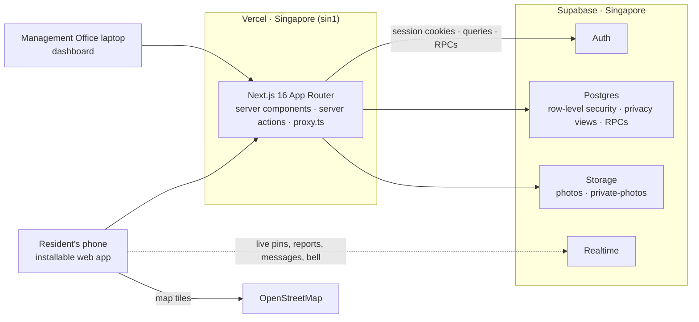

# Serumpun — how the system works

Serumpun ("of the same root") is a phone-first web app for the residents of a Sime Darby Property township, starting
with **City of Elmina**, and a laptop dashboard for its **Management Office**. Live at
**https://serumpun-six.vercel.app**.

Contents: [The problem](#1-the-problem) · [Feature tour](#2-feature-tour) · [Roles](#3-roles-and-verification) ·
[Architecture](#4-architecture) · [Data model](#5-data-model) · [Security](#6-security-model) ·
[Points](#7-points) · [Languages and themes](#8-languages-and-themes) · [Every township](#9-built-for-every-sdp-township) ·
[Demo accounts](#10-demo-accounts-and-reset) · [Run locally](#11-run-it-locally) · [Deploy](#12-deploy) ·
[Limits](#13-known-limits-and-later) · [Credits](#14-credits) · [Links](#15-links)

## 1. The problem

Today a township's life runs through a Facebook group. Reports to the Management Office get lost in the feed and
nobody knows whether anyone saw them. Warnings (stray dogs, a flood, a fallen tree) scroll away and go stale. Help,
events and things to lend are mixed with everything else, and residents' details are on show.

Serumpun puts it in one place, built around an **official reporting channel to the Management Office with public status
tracking**: every report has a reference number, a public timeline and a Me too count, and the office answers from its
dashboard. Around it: a live map of short-lived neighbourhood alerts, an emergency button that alerts the office and
neighbours within 2 km, notices to the office ahead of renovation or moving day, groups (with a General chat for
everyone, in topics like a Telegram community), events with points, services, share and lend, messages, facility
booking, vouchers, parking at SDP's malls, the mall directory and a household access card that opens the pool, the gym
and the courts with a tap. Home's favourites are the resident's to pick and order. Homes stay private: residents see names and neighbourhoods, never a unit number.

## 2. Feature tour

| Screen | Where | What it does |
|---|---|---|
| Register | `/register` (landing page: **Register with a code**) | The way onto a household card. Enter the code the Management Office gave you at its counter, or one a family member made for you (8 characters, shown as K7Q4-M29X; it works once and lasts 3 days) → **Is this your home?** (the unit, the owner or tenant on record and when the office checked the IC and the title) or the card you are joining and who invited you → an SMS code (an office code goes to the number the office has on record, an invite to the number you type; there is no SMS provider, so the code shows on screen) → choose a 6-digit PIN, twice → you are signed in on this browser and Me opens with your card ("Your card is ready · bound to this phone"). The Terms open in a new tab. |
| Sign in | `/sign-in` | Residents sign in with their mobile number → an SMS code (on screen, as above) → their PIN. A wrong PIN, a locked PIN and a number with no account all answer "The phone number or PIN is wrong." Office staff keep email and password, under **Management Office staff: sign in with email**. |
| Home | `/home` | Greeting, township and points; "Report an issue" (straight to the office); **My favourites**: up to 7 services of the resident's choosing (at first Pay parking, Notify office, Facilities, Events, Groups, Services, Rewards) and **More**; **Happening now**: the nearest neighbour alert, the office's latest announcement and your next event; **Open games** that need players. |
| More · Edit favourites | `/more` · `/more/edit` | Every service in three groups (Township, Community, Mall & parking), the new ones marked NEW. **Edit** (from Home): add or remove favourites, drag them into order (or Move earlier / Move later), Reset to the default, Save. Leaving without Save keeps the old ones. |
| Pay parking | `/parking/pay` | Pick Elmina Lakeside Mall or KL East Mall, type the plate (or tap one of your last 5), **Check amount**: the time parked and the fee pop up, with DuitNow QR, online banking (FPX), Apple Pay or Google Pay. A short "processing", then "Thank you! You have 20 minutes to exit the car park." A demo: nothing is charged. |
| Parking areas | `/parking` · `/parking/<mall>` | SDP's malls as cards (hours, rates); a mall opens its car park map (Elmina's, from SDP), Pay parking, rates, free parking, valet, EV charging, directions (Waze, Google Maps) and the Mall directory. |
| Mall directory | `/malls/elmina-lakeside-mall` | Elmina Lakeside Mall's 99 shops, A–Z, by name or unit and by category; tapping one drops a red pin on SDP's layout plan (pinch to zoom); facilities (toilets, surau, ATM, nursing room, playground, information counter) pin all their spots. |
| Emergency alert | ＋ in the bottom bar | Hold ＋ for 3 seconds (or Create › Emergency alert) and it turns into a red **!**; one more tap sends an alert from where you are. The Management Office and verified neighbours whose neighbourhood is within 2 km get a popup in the app and a bell, and a lock-screen alert on phones that turned it on (Me › Emergency alerts). Everyone's map shows a red 2 km circle while it is live (2 hours). The sender says what it is (fire, medical, break-in or crime, something else) or cancels a false alarm; **Call 999** is always one tap away. |
| Live Map | `/map` | Alerts as pins (accident, snake, suspicious person, stray dogs, flood, fallen tree, walkway blocked, streetlight, police, and the office's road works and water cuts). Neighbours vote **Still there** or **Gone**; an alert fades 2 hours after its last confirmation. Search, filters, drop an alert, and "Send to Management Office" for lasting problems. **Safe Walk**: pick the mall, the park, the courts or a spot on the map, and the walking route goes around confirmed high and medium hazards (blue, with the usual way dashed red and a banner saying what it avoided and how many minutes it adds), or warns when there is no way round. |
| Report an issue · Issue Board | `/reports/new` · `/reports` | Category, photo and place; "Already reported nearby?" offers **Me too** instead of a duplicate. Timeline: submitted → acknowledged → in progress → resolved, then the reporter confirms the fix (or it reopens). Private reports (security) are seen only by the reporter and the office. |
| Notify the office | `/notices/new` · `/notices` | Tell the Management Office ahead of renovation noise, moving day with the lift, an event at home or a contractor visit: dates and details. The office marks it noted, with a reply if needed, and the resident is told. Only the office sees it, with the unit. |
| Management Office | `/dashboard` | Reports board with updates and after-photos, official map pins, events to approve (points), resident notices, announcements, **General chat** topics (add, rename, office only, remove, or open one to answer), rewards and vouchers, and Reset demo data. A live emergency puts a red banner over every page (what, who, unit, phone, when) with Show on map and **Resolve**. |
| Units | `/dashboard/units` | Every home in the township with its household card: **Active**, **Suspended** (with the office's reason), **Lease ended**, **Code given** (until when) or **Not registered**, and how many of its 4 phones are in use. **Suspend…** asks for a reason (1 to 200 characters) that everyone on the card is told and sees; **Lift** puts the card back. **Give code** (a home with no card) is for the counter: the office checks the IC and the house title (a tenant's: the tenancy agreement) in person, ticks both, confirms the name, Owner or Tenant (a tenant's lease end) and the mobile number the person will register with, and the code appears once, with **Print slip** ("Open Serumpun and tap Register with a code"). It works once and lasts 3 days, and a new code cancels the old one. **Open reader screen** opens `/reader`. |
| General chat | `/community/general` | Pinned at the top of Groups, with every unread message as "N new". Topics as in a Telegram community: 📢 **Announcements** (office only; every announcement the office publishes appears here too), 🆘 Help & support, 💬 Borak-borak, 👋 Say hi, 🔎 Lost & found, 🚗 Traffic & roads, and any the office adds. Each topic is a live group chat (the office's messages marked "Management Office ✓"); opening it marks it read. Everyone in the township reads; verified residents and the office post. |
| Community | `/community` | **Groups** (General chat at the top; posts, questions with a top answer, Helpful), **Events** (each marked 🏢 Official · Sime Darby Property or 👥 Resident event, with its points; Going, QR check-in), **Services** (offers and requests in Tutoring, Repairs, Cleaning, Food, Childcare, Eldercare, Pets, Others; offers show their ⭐ average and jobs), **Share & Lend** (lend, give away or swap; borrowing in 4 steps; "Also post to a group" puts the item in one of your groups, where its post links to it). |
| Messages | `/messages` | One-to-one chats about a post, a service, a listing or an open game; live, with unread badges. In a chat about someone's offer, **Rate** gives it 1 to 5 stars (once per neighbour, changeable). |
| Facilities | `/book` | Badminton (2 courts), futsal, tennis, the hall, the gym, the BBQ pit and the function room. Free 1-hour slots from 7 am to 11 pm, up to 7 days ahead, 2 hours a day per household; a booking pass with QR and a calendar file; cancel up to 2 hours before. **Find players** (badminton, futsal and tennis): ask for 1 to 10 neighbours when booking; the game shows under **Open games** (here and on Home) until it is full, neighbours tap Join or message the host, and the pass shows who joined. |
| Rewards | `/rewards` | Vouchers for points at Elmina Lakeside Mall; "Slide to use" at the counter. |
| Me | `/me` | The **household card** at the top (next row); points and the next reward; my vouchers, reports, bookings, listings and notices; points history; **Help & policies**; emergency alerts on this phone; dark mode; **text size** (Small, Normal, Large, Extra large); language; township; sign out. |
| Household card | `/me` | A Wallet-style card: the Serumpun gradient, "HOUSEHOLD CARD", the unit (Aisyah's is No. 18, Jalan Elmina Valley 3/2), the places it opens (Facilities, Gym, Pool) and the phones on it ("3 of 4"), never a name. One card per household, so everyone on it gets the same places. Tap it and enter the 6-digit PIN (the demo accounts show it: 123456) and the card pops up; it locks again when you leave it or after 60 seconds without a tap. 5 wrong PINs lock it for 15 minutes and tell the card's Owner and Co-owner (on the shared demo accounts the lock stays in that browser and nobody is told). On a real phone the open card says "Hold near a reader". **Add to Apple Wallet (demo)** opens a sheet saying it is a look-alike; **Show QR instead** draws a QR that changes every 30 seconds. A suspended card shows "Suspended" with the office's reason, and a tenant's card shows "Lease ended" after the lease's last day. **A new phone** (a browser with no key on the card yet, signed in as the same person) waits: "This phone is waiting for your card. Have your old phone? Open Me there and move the card here. Old phone lost? The Owner or Co-owner approves it in Household. No one else can approve? Take your IC to the office." The old phone is asked **Move the card to your new phone?**: **Yes, move it** and its PIN move the card at once ("Your card is on another phone now." there), and **No, that wasn't me** turns the new phone away. |
| Household | `/me/household` (Me › the card) | Who is on the card, as Owner, Co-owner, Adult or Child, and the phones in use ("3 of 4"). The Owner, and a Co-owner whose IC the office has checked, **Invite someone** with their own PIN: a child (either of them), an adult (only while the Owner decides alone: with a checked Co-owner it needs both, which waits for stage 3's two-person approvals) or a Co-owner (the Owner, when the card has none). The code appears once, with **Send by WhatsApp**, and open invites are listed with **Cancel**. A card is full when its phones plus its open invites reach 4, so an open invite holds a phone place, and the page says so in place of the button. A person whose new phone waits for the card shows **New phone waiting**, and a manager can **Approve** it with their own PIN (for a lost phone, never for themselves). Me asks an Owner with no Co-owner to **Add a Co-owner?**; Later puts it off for 3 days on that browser. |
| Reader | `/reader` | A tap reader for the demo laptop, open to anyone (no sign-in). Pick where it is: Facilities (then a court, the hall, the BBQ pit or the function room), Gym or Pool. The phone mockup beside it holds the card of whoever is signed in on that browser (the demo buttons when nobody is). Open the card with the PIN, then drag it onto the reader or press **Tap**: the phone buzzes, and the reader shows a big green tick and "Access granted · Pool", or a red ✕ and one reason (card suspended, lease ended, phone switched off, place switched off, no booking at this time, pass expired). It never shows a name. Facilities and the Gym open only with the household's booking for that hour; the Pool is walk-in. The **Wi-Fi** switch (or the laptop really going offline once the page has loaded) makes the reader decide by itself, and visits made offline are sent when it is back. |
| Help & policies | `/help/guidelines` · `/help/rules` · `/help/faq` · `/help/terms` | How to use each feature, the community rules, an FAQ with search, and the Terms & Conditions (a draft for the competition). Readable signed out too: Register links its Terms. |
| Notifications | `/notifications` | Emergencies nearby, report updates, borrow steps and a reminder at 8 am on the return day (to the borrower and the owner), comments, events approved or not for points, players joining or leaving your game (or a game you joined being cancelled), a notice noted by the office (and, for the office, a new notice), announcements and account news, with a live bell. |

**The 5-minute demo story**

1. Landing → **Try as Aisyah** → switch to Bahasa Malaysia (Me › Language).
2. Home › Happening now → the nearest alert opens the **Live Map** on it → vote Still there → **Safe Walk** to Elmina
   Lakeside Mall goes around the stray dogs on the park track.
3. **Report** a broken streetlight → "Already reported nearby?" → **Me too** → open the report's timeline.
4. On a laptop: **Try as Management Office** → move a report to *In progress* with an update → Aisyah's phone updates
   **live** → the Issue Board.
5. **Events**: check in with the event's QR → points → **Rewards** → redeem Free kopi → slide to use.
6. **Community**: General chat › Borak-borak (3 new) and Help & support, where the office answered · the Mommies
   group's top answer · message a tutor and rate her ⭐ · borrow a ladder · **Facilities** with Find players (Daniel
   joins Aisyah's Saturday game from Open games, and her bell and booking pass show it).
7. **Mall**: Home › **Pay parking** → Elmina Lakeside Mall → tap WXY 1234 → the amount → DuitNow QR → "Thank you! You
   have 20 minutes to exit" → **Parking areas** → the Mall directory → Jaya Grocer's pin on the layout plan.
8. **Emergency**: on Aisyah's phone hold ＋ for 3 seconds and tap the red **!** → Daniel's phone pops up "Emergency
   nearby" and his map shows the red 2 km circle → the office's dashboard shows who and where → Resolve.
9. **Me**: Help & policies, dark mode and text size; Home › Edit to rearrange favourites. Close on "built for every SDP
   township".

**The household card, in about two minutes** (two browsers, because one browser holds one account: Aisyah on the
laptop, the office in a second one)

1. Landing → **Try as Aisyah** → Me: the card at the top says No. 18 and "3 of 4" phones. Tap it and the PIN pad shows
   the demo PIN, 123456. Enter it and the card pops up.
2. On the laptop open `/reader` (still as Aisyah) and pick **Pool**. Open the card in the phone mockup with 123456, then
   drag it onto the reader, or press **Tap** → the phone buzzes → a green tick and "Access granted · Pool".
3. Pick **Gym** and tap again → a red ✕ and "No booking at this time" (the Gym and the courts open only with a booking
   for that hour).
4. Turn the **Wi-Fi** switch off and tap at the Pool → still green, because the reader decides from the card and its
   last sync. Turn it on and the visit it queued is sent.
5. In the second browser: **Try as Management Office** → **Units** → **Suspend…** No. 18 with a reason ("Landlord's
   request") → Aisyah's next tap is a red ✕ and "Card suspended" → **Lift** → the next tap is green again.

## 3. Roles and verification

| Who | Can |
|---|---|
| Visitor | See the landing page, register with a code, sign in, or try a demo account. |
| Resident | Everything residents do. Their account is verified from the moment they register, and they are on a household card as its Owner, Co-owner, Adult or Child. |
| Rejected | Sees why, and nothing else. No screen turns anyone down any more; stage 5 replaces this with the access-ended screen. |
| Management Office | Its township's dashboard. |

Nobody signs up and waits for approval any more. A resident gets a **code**: the Management Office gives one at its
counter after checking the IC and the house title or tenancy agreement in person, or a manager of a household card makes
one for family. Registering with it (§2) writes the account as verified, with the card's unit as its unit. Only the
Management Office ever sees the unit and the phone.

## 4. Architecture



- **Reads**: server components query Supabase as the signed-in user, so row-level security always applies.
- **Writes**: server actions call database functions (RPCs) that check the caller and the rules again; the page is never
  trusted. The service-role key is used only by trusted server code (sending notifications, the seed, the smoke test,
  registering and phone sign-in, moving a card's key, and two reads a signed-in user can't make: a unit's record phone
  and whose new phone is waiting).
- **Live updates**: alerts, reports and emergencies broadcast an id-only "something changed" on the township's channel
  (emergencies also on their own, for the popup on every page) and pages fetch again through the privacy views; messages,
  General chat's topic messages and notifications arrive as row changes under row-level security.
- **Parking** runs on the server only (`lib/parking.ts`, service role): the page sends the plate, the server works out
  the pretend entry time and the fee, and a payment marks the session paid once.
- **Lock-screen alerts** (emergencies only) use Web Push: Me › Emergency alerts registers the service worker
  (`public/sw.js`) and subscribes the browser with the app's VAPID public key; the subscription is kept in
  `push_subscriptions`. Once the sender has their answer, the server (`after()`) sends each recipient a notification in
  their language with `web-push`, and drops subscriptions the push service says are gone.
- **Time**: every "today", slot and window is worked out in Malaysia time (Asia/Kuala_Lumpur); servers run in UTC.
- **Maps** use Leaflet with OpenStreetMap tiles (no paid keys). QR codes are made in the app.
- **Safe Walk** routes in the phone: Elmina's walking paths from OpenStreetMap (`public/data/elmina-walk.json`, built
  by `scripts/build-walk-graph.mjs`) load the first time it is used, and A* finds the shortest way, then the shortest
  way that keeps 40 m from every confirmed high or medium hazard. It is worked out again whenever the alerts change.
- **Scheduled**: Vercel Cron calls `/api/cron/reminders` every day at 00:00 UTC (8 am in Malaysia, `vercel.ts`) with the
  project's `CRON_SECRET`; it sends the return-day reminders once per day, however often it is called.

| Folder | What is in it |
|---|---|
| `app/(auth)` | Landing, Register, Sign in, the rejected screen |
| `app/(app)` | Every resident screen |
| `app/dashboard` | The Management Office |
| `app/reader` · `app/api/reader` | The public reader screen and its API (sync, tap, visits) |
| `components/<feature>` | Screens' parts, by feature |
| `lib/domain` | The rules as plain, tested functions (time, points, booking, reports, alerts…) |
| `lib/card` | The household card: signing and checking passes, the tap decision, the PIN rules, codes and registering, who may invite and approve, the reader's offline queue |
| `lib/route` | Safe Walk's walking graph and route finder |
| `lib/supabase` | Clients, the session and role checks, realtime hooks |
| `lib/i18n` | English and Bahasa Malaysia (`en.ts`, `ms.ts`) |
| `lib/seed` | The demo township |
| `supabase/migrations` | Schema, row-level security and RPCs, applied in order |
| `scripts` | `migrate.ts`, `seed.ts`, `seed-cards.ts`, `smoke.ts`, `card-key.ts`, and `build-walk-graph.mjs` (refreshes the walking paths) |
| `tests` | Vitest unit tests |

## 5. Data model

Every township-level table has `township_id`. Residents read through the views and functions in the last column.

| Area | Tables | Residents read through |
|---|---|---|
| People | `townships`, `profiles` (with Home's `favourites`), `profile_private` (the card's unit, and the phone they registered with: one account per number) | their own profile and unit |
| Office | `announcements`, `notifications`, `resident_notices` | their township's announcements, their own notifications and notices |
| Live Map | `alerts`, `alert_votes` | `public_alerts` |
| Emergencies | `emergencies`, `push_subscriptions` | `public_emergencies` (where and what, never who); phone subscriptions not at all |
| Reports | `reports`, `report_metoo`, `report_updates`, `report_confirmations` | `public_reports`, `public_report_updates` |
| Events and points | `events`, `event_rsvps`, `points_ledger` | `public_events`, `my_points()` |
| Rewards | `rewards`, `redemptions` | the catalogue, their own vouchers |
| Groups | `groups` (one `is_general` per township, which every verified resident joins), `group_members`, `posts`, `comments`, `comment_helpful` | `public_groups`, `public_group_members`, `public_posts`, `public_comments` |
| General chat | `chat_topics` (one `announcements` per General chat), `topic_messages`, `topic_reads` | `public_topics` (with the latest message and the reader's unread count), `public_topic_messages`; new messages live under row-level security |
| Parking | `vehicles` (a resident's last 5 plates), `parking_sessions` | nothing: only the server, for the signed-in resident |
| Messages | `conversations`, `conversation_members`, `messages` | `my_conversations`, their own messages |
| Services | `services`, `service_reviews` | `public_services`, `public_service_ratings` (the stars, never who gave them) |
| Share & Lend | `listings`, `borrow_requests` | `public_listings`, `my_borrows` |
| Facilities | `facilities`, `bookings`, `booking_players` | the courts, their own bookings, `booked_slots()`, `open_games()`, `game_players()` (the host's own game) |
| Household cards | `units` (the office's record of a home, with a tenant's lease end), `cards` (one per unit: active or suspended, the places it opens, its phone limit), `card_members` (who is on a card, as Owner, Co-owner, Adult or Child), `card_phones` (a card's phones, one per person) | their own card, its unit, who is on it and its phones (never a unit's record phone); the office reads its township's |
| Getting onto a card | `card_codes` (the office's code for a home with no card, and the family's invites to a card: kept only as a hash, open until used, cancelled or out of date), `sms_checks` (an SMS code sent to a number: kept only as a hash, good for 10 minutes and 5 tries) | the office its township's office codes, and members their card's invites, both without the hash; SMS checks not at all |
| Taps and PINs | `phone_keys` (the public key of each browser that holds a phone's card, in one of three states: **active**; **waiting**, a new browser's key until the old phone or a manager moves the card to it; **retired**, after it moved away or was declined), `card_visits` (every tap, by card), `member_pins` (a person's PIN, hashed, with wrong tries and any lockout) | their own phone's keys and their card's visits (by unit, never a person); the PINs not at all |

## 6. Security model

- **Row-level security on every table.** Policies go through `my_township()`, `is_verified()` and `is_management()`,
  so a rejected account matches nothing and nobody sees another township.
- **Privacy views.** Residents read names and neighbourhoods only: never a unit number, a phone, who posted an alert or
  a report, who raised an emergency, or who rated a service. Tables that would leak (votes, Me toos, who wrote a step, who joined a game, who
  rated) give residents nothing at all.
- **Emergencies**: only the office learns who raised one, with the unit and phone, to send help. Only the sender can
  cancel it and only the office resolves it. Only a verified resident can raise one (every registered resident is), and
  tapping again while one is live gives the same one back, so nobody is alerted twice.
- **Notices** to the office are seen by the resident who sent them and the office, nobody else.
- **Ratings need a real contact**: a service can be rated only by a neighbour who has a conversation with its provider
  about it, never by the provider.
- **Writes only through RPCs**: security-definer functions with an empty `search_path` and explicit grants. Each checks
  who is calling (verified, same township, owner) and the rule (dates, slots, steps, limits) again.
- **Photos** get random file names. A private report's photos sit in a private bucket, shown through short-lived signed
  links.
- **Only trusted code sends notifications**, so nobody can message a fake notice.
- **Double taps count once**: unique keys and locks make Me too, check-in, redeem (a request id per press), borrowing,
  booking (one per slot, 2 hours per household) and joining a game (one spot each, never past full) safe to tap twice or
  at the same time.
- **General chat**: everyone in the township reads its topics; verified residents and the office post, only the office
  posts in an office-only topic, and only the office adds, renames or removes topics. Announcements can be neither
  removed nor opened to residents.
- **Parking**: residents have no access to the plates and sessions tables at all; the server reads and writes them for
  the signed-in resident only, and a session is paid once, however often Pay is tapped.
- **Household cards**: residents read only their own card's rows (its unit, who is on it, its phones, its open invites and
  visits, their own phone's keys) and the office its township's units, cards, people, phones and office codes, but no
  visits (incident lookups come in a later stage). Every write goes through a function that checks the caller again, or
  through the server. `member_pins` has no policy and no grant, so nobody signed in can read a PIN, and a unit's record
  phone is read by the server only, for the office, after it has checked who is asking. Only the office suspends a card (in
  its own township, with a reason of 1 to 200 characters that everyone on the card sees) or lifts the suspension, and only
  the office gives a home with no card its code (the demo's seed and Try registering do too, from the server).
- **Codes and SMS codes**: a code is 8 characters from 32 that can't be misread (no I, O, 0 or 1): 40 random bits, and
  the database keeps only its SHA-256 and finds a code by it. Nobody signed in is granted that column, so the office
  reads when a code ends, never the code. A code works once and lasts 3 days, and a new office code for a home cancels
  the old one. An SMS code is 6 digits kept as a bcrypt hash, good for 10 minutes and 5 tries. None of them is logged,
  and a code never goes in one of our URLs: Try registering brings its code in an httpOnly cookie. The one link that
  carries a code is the invite's **Send by WhatsApp**, because sending it is that button's purpose; the code works once,
  lasts 3 days and still needs the invitee's own number, SMS check and PIN.
- **Registering and phone sign-in** run on the server with the service role, because nobody is signed in yet, and the
  database checks every rule again. Registering makes the account (a made-up `resident-<id>@example.com` that can't
  receive mail, with a random password nobody keeps), then `complete_registration` checks the code, the SMS check and the
  number (one account per number) and puts the person on the card with their profile (verified), phone and PIN. If the
  database refuses, the account is deleted again, so nothing is left half-made. Signing in needs a checked SMS code and
  then the PIN; with the right PIN the server makes a magic link for the account's made-up email, never sent, and uses it
  at once to start the session, so there is no password to leak and no new secret. Signing in never shows whether a
  number has an account: an unknown number, a wrong PIN and a locked PIN all answer "The phone number or PIN is wrong.",
  and each takes one bcrypt (`0025a`, `0025b`), so the timing doesn't tell them apart either. Keep the bcrypt costs in
  step: the seed's `set_member_pins`, `complete_registration` and the dummy check all use the default `gen_salt('bf')`.
- **Moving a card to a new phone**: a resident's phone holds one active key, and a second browser's key waits. The old
  browser moves the card by signing a fresh note on its pass, which proves it holds the key that is leaving: the server
  checks the township's signature on the pass and the key's on the note (within a minute either way), and only then,
  with the person's PIN, calls `move_phone_key` with the service role, for the signed-in person alone, because the
  database can't check an ECDSA signature. The old key is retired and the waiting one takes its place, and an online
  reader refuses a retired key at once. For a lost phone the Owner, or a Co-owner whose IC the office has checked,
  approves with their own PIN (`approve_phone_move`), never for themselves: the Owner's needs the checked Co-owner, and
  the Co-owner's the Owner. A newer waiting key retires an older one, and **No, that wasn't me** retires the waiting key.
- **Passes and phone keys**: the server signs a pass for each phone with the township's private key (`CARD_SIGNING_KEY`,
  ECDSA P-256, in the server's environment only), good for 24 hours and renewed whenever the app is open and online.
  Each browser makes its own key pair (WebCrypto, not exportable, kept in IndexedDB) and registers only the public
  half, which the pass carries. A tap is the pass plus a short note signed by that key (place, time, a random number):
  a copied pass or a screenshot of the QR is useless, a note counts for about a minute and works once (its number is
  unique in the visit log), and readers store no phone keys. An online reader asks the server, which checks the live
  card, phone, places and booking, so a suspension acts at once; an offline reader decides from the pass and its last
  sync. A browser renews its pass whenever the card is open and online. **A waiting answer** drops any pass the browser
  holds (a waiting key never has a pass of its own, and the browser may still hold another account's), a pass for another
  card is dropped when the card opens, and a network error during a wait keeps the "waiting" note and asks again every
  5 seconds.
- **PINs**: 6 digits, hashed with bcrypt in the database. 5 wrong tries lock a PIN for 15 minutes and tell the card's
  Owner and Co-owner. Every visitor shares a demo account, so for those the wrong tries are counted in each browser,
  nobody is told, and one visitor can't lock the rest out.
- **No names at a reader**: it never shows one, and the visit log records the card (so the unit), the place, the time
  and the result, never the person or the phone.
- **Every page and action checks the session itself.** `proxy.ts` only sends signed-out visitors to the landing page.
- `npm run smoke` tries these rules against the live database as the demo accounts (25 checks).

## 7. Points

- **Earn** by checking in at an event with its QR, from an hour before it starts to three hours after: **150** points
  at the Management Office's events, **100** at a resident event once the office approves points for it. Once per
  person per event.
- **Spend** on vouchers at Elmina Lakeside Mall: Free kopi (250), RM10 off groceries (500), an hour at the kids'
  playland (600), RM15 off sportswear (1,500). A voucher lasts 30 days and is used by sliding it at the counter, beside a
  ticking clock so a screenshot cannot pass for it.
- The balance is the sum of the points ledger. Only check-in adds points and only redeeming spends them.

## 8. Languages and themes

Every screen is in **English** and **Bahasa Malaysia** (Me › Language; the choice is remembered). **Light**, **dark** or
the phone's setting (Me › Dark mode). **Text size** Small, Normal, Large or Extra large (Me › Text size, remembered on
the device): every screen grows with it and still fits a phone. Designed for phones 390 px wide, installable to the home
screen; the dashboard is for laptops.

## 9. Built for every SDP township

The `townships` table lists Sime Darby Property's townships: City of Elmina (live), Bandar Bukit Raja, Serenia City,
Ara Damansara, Bukit Jelutong, Nilai Impian, Bandar Ainsdale and Putra Heights. Only City of Elmina has homes, an office
and codes; the others are listed, not switched on. Everything is scoped by township, so opening another one means
switching it on, adding its Management Office account, its homes (units), places, facilities and rewards, and its General
chat with its topics (as `supabase/migrations/0017_general_chat.sql` and `0022_chat_topics.sql` did for City of Elmina;
residents then join it as they register).

## 10. Demo accounts and reset

- The landing page has **Try as Aisyah** (resident, Elmina Valley 3), **Try registering (Nur)** (a home with no card,
  where you register as a new resident) and **Try as Management Office**. Nur is not an account any more: the button
  makes her afresh each time.
- **Daniel Tan** (`daniel.demo@example.com`, another household) is a second resident for two-phone demos. The demo
  password is not in this document: ask the team.
- **The household card.** The demo PIN is **123456** for every seeded resident, and the PIN pad shows it on the demo
  accounts. Aisyah is the Owner of No. 18, with Imran Yusof as Co-owner and Sara Imran as a child: "3 of 4" phones. Many
  visitors can be Aisyah at once; each browser makes its own key, but all join her one seeded phone, so the card keeps
  saying "3 of 4".
- **Try as Aisyah puts No. 18's card back as it was seeded** (active, all three places on, no phone frozen) before it
  signs her in, so each judge starts with a working card. It happens only on that tap, so a suspension the office makes
  during a video take stays put until the next Try as Aisyah or a reset. A failed restore is logged and the sign-in
  goes on.
- **Try as Aisyah also removes the invites and the people they brought in.** It cancels No. 18's open invites and deletes
  the accounts on its card that have a phone on record, because only an invite brings anyone but the seeded Aisyah,
  Imran and Sara onto this card (and the seeded three have no phone). So after a judge invites and registers someone, the
  next Try as Aisyah puts No. 18 back at "3 of 4" with no invites, and that person can no longer sign in. Nobody on any
  other card is touched.
- **Try registering (Nur)** starts her registration over. It deletes the accounts on No. 25's card (a visitor may have
  invited family there) and whoever holds her made-up number, +60 10-000 0025; deletes the card; puts the office's record
  back (Nur Iman, Owner, that number); and gives No. 25 a fresh code, which it hands to Register in a 10-minute httpOnly
  cookie, never the URL. The code is already filled in: confirm the home, read the SMS code off the screen (the number
  can't receive one), choose a PIN, and Me shows No. 25 at "1 of 4".
- **Each new private window is a new phone.** A browser makes its own key, so signing a resident in on a second browser
  (or a private window) asks to move the card, and the card waits there (§2, §6). Only the shared demo accounts, Aisyah
  and Daniel, let every browser join their one seeded phone.
- **Two visitors registering Nur at once cancel each other's code**: a new code cancels the old one, and starting over
  deletes the Nur the other visitor just made, so the first one's sign-in answers "The phone number or PIN is wrong." and
  their unfinished registration says the code no longer works. Tap again to start over.
- **Never run `npm run db:seed:cards` during a video take**: it resets every card and PIN lockout, which undoes a
  suspension. (`npm run db:seed` and Reset demo data do too.)
- **Dashboard › Reset demo data** (or `npm run db:seed`) wipes everything created since, deletes every account the seed
  doesn't name (visitors' registrations, one a failed registration left behind, and stage 1's Nur), restores the demo
  accounts and seeds a lively Elmina dated around now, with the card tables again: 25 units, 14 cards (Jason Lee's tenant
  card suspended, Kavitha Nair's lease ended), their people and phones, and the demo PIN. Nur's home is ready to
  register, and No. 61 shows a code given. Seeded alerts fade after about two hours, so reset shortly before a demo.

## 11. Run it locally

You need Node 24, npm 11, and access to the Vercel project (or your own Supabase project with the same variables).

```bash
npm install
vercel env pull .env.local
npm run card:key   # only adds CARD_SIGNING_KEY when .env.local has none
npm run db:migrate
npm run db:seed
npm run dev
```

Variables (names only, never commit `.env*`): `NEXT_PUBLIC_SUPABASE_URL`, `NEXT_PUBLIC_SUPABASE_ANON_KEY` (or
`NEXT_PUBLIC_SUPABASE_PUBLISHABLE_KEY`), `SUPABASE_SERVICE_ROLE_KEY` (or `SUPABASE_SECRET_KEY`),
`POSTGRES_URL_NON_POOLING` (or `POSTGRES_URL`) for migrations, `DEMO_PASSWORD`, `CARD_SIGNING_KEY` (the township's key
for household cards: it lives in `.env.local` and Vercel, is never committed or printed, and `npm run card:key` makes it;
without it nobody gets a pass, so no card opens), `CRON_SECRET` (any long random
value; Production has its own, and the reminders route refuses every call without it), and `NEXT_PUBLIC_VAPID_PUBLIC_KEY`
with `VAPID_PRIVATE_KEY` (a pair from `npx web-push generate-vapid-keys`; without them everything works except
lock-screen alerts).

| Script | Does |
|---|---|
| `npm run dev` | Development server |
| `npm run build` · `npm run start` | Production build and server |
| `npm run lint` · `npm run typecheck` · `npm test` | ESLint, TypeScript, Vitest |
| `npm run db:migrate` | Applies new files in `supabase/migrations`, each in one transaction |
| `npm run db:seed` | Resets the demo data |
| `npm run db:seed:cards` | Adds and updates the card rows (units, cards, who is on them, phones, PINs, No. 61's code) and deletes nothing, but resets every card and PIN lockout: never during a video take. On a database seeded before stage 2 it stops at three renamed phones (Wei Ming's, Farah's, Mei Ling's): run `npm run db:seed` once first |
| `npm run card:key` | Adds `CARD_SIGNING_KEY` to `.env.local` when it has none. It never prints the key |
| `npm run smoke` | Privacy, double-tap, limit, household-card and getting-onto-a-card checks on the live database, then a reset |

Two sessions on one computer (resident and office): `npm run build && npm run start -- -p 3001`, then use
`http://localhost:3001` and `http://127.0.0.1:3001` (the development server blocks 127.0.0.1).

## 12. Deploy

The Vercel project `serumpun` runs in Singapore (`vercel.ts`), with Supabase from the Vercel Marketplace. Its variables
are set in the project for Production, Preview and Development.

`CARD_SIGNING_KEY` goes into all three: read it from `.env.local` inside a script and pipe it to
`vercel env add CARD_SIGNING_KEY <environment>` with `process.stdout.write`, so it carries no trailing newline (a newline
makes every pass fail), and never print it. Development gets it too, so `vercel env pull` cannot wipe the local key.

```bash
npm run typecheck && npm test && npm run build
npm run db:migrate
vercel deploy --prod
npm run smoke
```

Apply new migrations before deploying code that needs them. The smoke test ends with a reset of the demo data. The card
tables are filled by the seed, so after the first deploy with the household card run `npm run db:seed:cards` to give the
live demo its cards without touching anything else (never during a video take). `npm run db:seed` or Dashboard › Reset
demo data fills them too, but resets all the demo data, visitors' registrations included.

## 13. Known limits and Later

- **Open games and the booking pass** show who joined when they are opened or after your own tap; the host's bell is the
  live part. Find players is set when booking, not changed afterwards.
- **Return-day reminders** go out once a day at about 8 am (on Vercel's Hobby plan a daily job may start any time in
  that hour), and only for items the owner marked as picked up.
- **Emergency alerts** reach neighbours by the centre of their neighbourhood, not where their phone is. The sender's
  place is the phone's location when it is in the township (asked for at most 6 seconds), else their neighbourhood's
  centre. An alert fades from maps after 2 hours and stays on the office's dashboard until resolved. Lock-screen alerts
  need the browser to allow notifications, and on an iPhone the app added to the Home Screen (iOS 16.4 or later).
- **Text size** is remembered on each device, not on the account.
- **Safe Walk** knows only the paths OpenStreetMap has (refresh them with `node scripts/build-walk-graph.mjs`), sets off
  from your neighbourhood's centre when the phone gives no location in the township, and does not guide turn by turn.
- **Pay parking is a demo**: nothing is charged, the time parked is made up from the plate, and Elmina Lakeside Mall's
  hourly rate is a sample (KL East Mall's is its published rate). The thank-you gives 20 minutes to exit at both malls.
- **Mall directory** is for Elmina Lakeside Mall only. Its 99 shops and units are from SDP's site as of 18 Oct 2026 (the
  page loads more as you scroll, so a few may be missing); categories are ours, and the pins were placed by hand on
  SDP's layout plan.
- **General chat** shows a topic's latest 100 messages; messages cannot be edited or deleted yet.
- **The household card is stage 2 of 6 (getting onto the card).** Stage 1 was the tap. Stage 2 adds codes at the counter,
  registering with one, signing in with a phone and PIN, family invites with a first household page, and moving to a new
  phone; self sign-up is gone. The rest of running the household (places on and off, freezing a phone, two-person
  approvals, the changes log and the access history), guest passes and bookings, disputes and appeals, recovery codes,
  changing the Owner or Co-owner, the access-ended screen and the plastic card come in later stages (see the design
  spec). Until stage 3 an Owner with a checked Co-owner cannot invite an adult, which needs both of them. Visits are kept
  until a later stage adds the 90-day deletion and the office's incident lookups.
- **No real NFC, Bluetooth, Apple Wallet or SMS.** The tap is simulated (drag the card onto the reader, or press Tap),
  the reader is a web page, and the browser on it plays the phone. **Add to Apple Wallet (demo)** is a look-alike: a real
  pass needs a paid Apple Developer account, and passes that open doors need Apple's approval. There is no SMS provider.
- **The SMS code shows on screen**, so it proves nothing about who holds a number: in the demo the **PIN** is sign-in's
  secret. With a real provider the code would go to the phone, and a PIN would be the second thing a thief needs.
- **Registering with an open invite code shows whether a number already has an account** (`phone_taken` or success),
  because with the SMS code on screen nothing else proves the number, and success or failure itself gives it away, so no
  shared wording could hide it. This is a limit of the demo, beside the one above: with a real provider only the number's
  holder gets that far. An office code can't be used this way, because it texts only the number the office checked.
- **A move doesn't sign the old phone out.** The old browser stays signed in to the app; only its card stops (its key is
  retired, so online readers refuse it at once).
- **Someone who loses their phone and has no one to approve it waits for stage 5.** A new phone's card asks the old phone
  to move it, or the Owner or Co-owner to approve it in Household. When no one else on the card can approve (someone alone
  on it, or an Owner with no checked Co-owner) the screen says "No one else can approve? Take your IC to the office."
  The office has no tool for it yet: stage 5's recovery codes and changing the Owner or Co-owner are it.
- **Screenshots and rooted or jailbroken phones can't be blocked** by a web app. Instead each tap is signed by the
  phone's own key and the fallback QR changes every 30 seconds, so a screenshot or a copied card is useless.
- **iPhones don't vibrate** at a tap (iOS browsers ignore `navigator.vibrate`); the tick or cross, and the shake on a
  refusal, still show.
- **An offline reader learns of a change at its next sync, or when the phone's pass expires (within 24 hours).** That
  covers a suspension, a lift, a frozen phone and a moved phone: "Yes stops the old phone at once" holds at online readers
  only, which ask the server and need an active key.
- **A browser that can't keep the card's key** (a Safari private window, some in-app browsers) says so and can't hold
  the card.
- **Not in this version**: real payments (Pay parking is a demo, services are paid between neighbours, facilities are free), push notifications
  other than emergencies (the rest are in the app), checking in at a court (the "3 no-shows" rule is shown, not enforced), offline use (the reader screen aside), and photos for
  listings (they have an emoji).
- **Approximations**: "how far" on Share & Lend, Facilities, Home and the emergency popup is measured from the centre
  of your neighbourhood, never from a home.
- The demo shares one database between local, preview and production, and a reset wipes everything created since.

## 14. Credits

Logo, app icon and line icons by the Serumpun team (originals in `brand/`; the app's copies in `public/brand`,
`public/icons/line` and `app/icon.png`). Map data and Safe Walk's walking paths © [OpenStreetMap](https://www.openstreetmap.org/copyright) contributors,
available under the Open Database License (ODbL). Elmina Lakeside Mall's car park map and layout plan © Sime Darby
Property. Maps by Leaflet. Built with Next.js, React, Tailwind CSS, Supabase and Vercel. Font: Plus Jakarta Sans
(SIL Open Font License). Made for the SDP Hackathon 2026.

## 15. Links

- Design spec: [`docs/superpowers/specs/2026-10-13-serumpun-design.md`](superpowers/specs/2026-10-13-serumpun-design.md)
- Build plan: [`docs/superpowers/plans/2026-10-13-serumpun.md`](superpowers/plans/2026-10-13-serumpun.md)
- Household access card: [design spec](superpowers/specs/2026-10-19-household-access-card-design.md),
  [stage 1 plan](superpowers/plans/2026-10-19-access-card-stage-1.md) and
  [stage 2 plan](superpowers/plans/2026-10-25-access-card-stage-2.md)
- Approved mockups (canvas): https://claude.ai/artifact/Bqa6n1zS9ZeR5BGtrUur73
